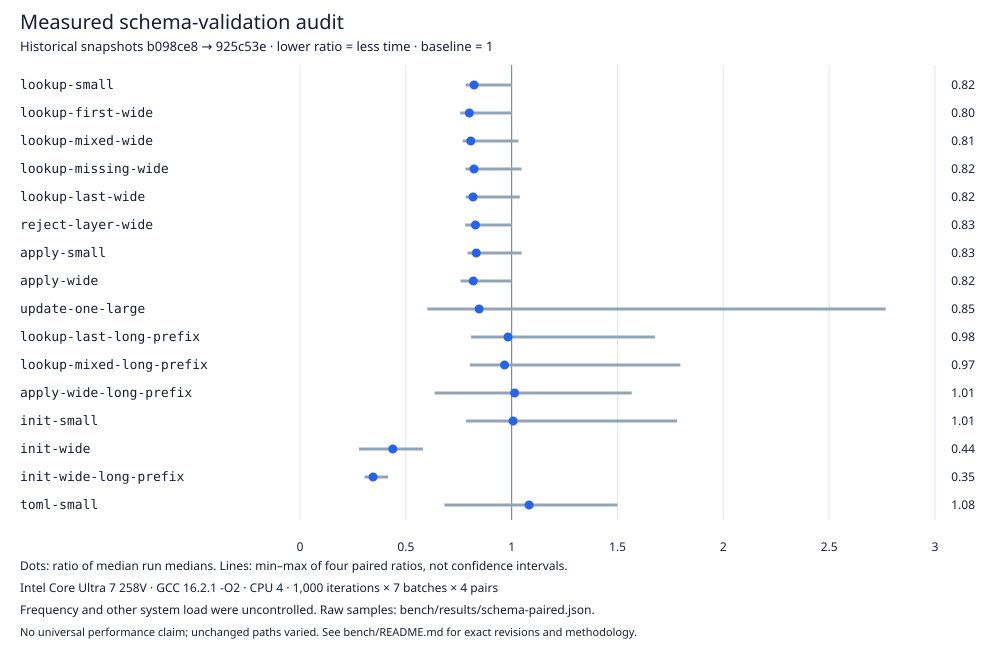

# Configuration benchmarks

The latest [scalar update audit](../docs/scalar-update-performance.md) retains
all original fixtures, six update/control workloads, raw paired/repeat samples
and regressions for the exact-size scalar fast path.

The [initialization follow-up](../docs/initialization-performance.md) measures
the validator/comparator change, including all sixteen fixtures and regressions.
The earlier [storage and native-binding audit](../docs/v010-results.md) retains
all loading fixtures, mixed results, the observed CPU7 overlap and a separate
handoff repeat. Earlier records below remain historical measurements.

Run `make bench BENCH_ITERATIONS=1000` from the library root. The harness builds
one native GCC `-O2` executable and takes seven timed batches per fixture,
printing each raw sample in ns/operation plus median, min, max and checksum.
A second independent invocation checks repeatability. The paired-revision
workflow below provides stronger before/after control for optimization work.
Fixture/schema setup is outside the timer; validation, output checking, checksum consumption, loop
work, getters used to verify results, and error creation are inside it.
Successful layers reuse a Store without retaining history. General transactions
rebuild the arena; one present scalar with an equal combined source/text length
can overwrite its existing span after staging. There is no external I/O in the timed loop.

## Fixtures

- `lookup-small`: successful first-key Text getter in an eight-field schema;
  best-case linear lookup, 32-byte values.
- `lookup-first-wide`: first declared key in a 256-field schema, keeping the
  first-field fast path visible rather than hiding its possible regressions.
- `lookup-mixed-wide`: deterministic traversal of all 256 successful keys.
- `lookup-missing-wide`: failed getter in a 256-field schema, including safe
  diagnostic construction.
- `lookup-last-wide`: successful getter for the final key in that same schema.
- `reject-layer-wide`: stage a valid first override, reject an unknown second
  key, then check the previous first value remains unchanged.
- `apply-small`: replace all eight 32-byte Text values and read the first one.
- `apply-wide`: replace all 256 32-byte Text values and read the first one.
- `update-one-large`: initialize 256 × 4096-byte Text values, then alternate
  one key between `a` and `b`. The initial first-key value shrinks on the first
  timed call, requiring a full rebuild. Before the equal-size scalar fast path,
  every call copied the other 255 large values; current steady updates qualify
  for the fast path. The full-rebuild controls in `bench/updates.goose` retain
  the approximately 1 MiB live arena while changing sizes, lists or multiple keys.
- `lookup-last-long-prefix`, `lookup-mixed-long-prefix`, `apply-wide-long-prefix`:
  the corresponding wide cases with 240 identical prefix bytes in every key.
  They expose byte-comparison costs that short keys can hide.
- `init-small`, `init-wide`, `init-wide-long-prefix`: repeated schema initialization
  plus a checked missing getter. They expose the sorted index's construction
  overhead. The schema and key strings are built outside the timer.
- `toml-small`: alternate two two-setting TOML documents, including parse,
  strict kind checking, transaction commit and a checked integer getter.

All fixtures assert acceptance/rejection and consume results. Untimed final
checks verify every setting and source after each fixture. These are local
microbenchmarks, not production throughput, an allocation benchmark, a general
ranking, or a claim about other configuration libraries. In the original
measurement, no CPU affinity or frequency governor was controlled; other processes and CPU frequency scaling
can affect results. There is no separate warmup pass; the store is initialized
before timing, and the first batch can include cold effects. Report all raw
samples rather than selecting the fastest batch. CI runs small smoke workloads
without timing thresholds.

## Original measurement

Raw samples: [current run](results/current.txt), [independent repeat](results/repeat.txt).
Environment and exact source/toolchain revisions: [metadata](results/environment.txt).
Results use 1,000 operations per batch on an Intel Core Ultra 7 258V under Linux,
GCC 16.2.1. The compiler and vendored parser are pinned. The native compiler
commands are `gcc -O2 -c <runtime.c> -o <runtime.o>` and
`gcc -O2 <program.c> <runtime.o> -o <binary> -lm -pthread -ldl`.

## Paired audit measurement

The reproducible audit uses the same current 16-fixture harness for both exact
source revisions and checks equal checksums for every run. To reproduce:

```sh
python3 bench/measure.py --goose /absolute/path/to/goose \
  --before-ref 3305e6d --after-ref 56677f1 --iterations 1000 \
  --pairs 4 --cpu 4 --output bench/results/audit-paired.json
```

The script exports just the three library source files from each immutable
revision under a private temporary directory inside ignored `.build/paired`,
builds both with GCC `-O2`, and runs
four pairs in alternating before/after order. It records all seven samples per
fixture, exact revisions, harness SHA-256, flags, hardware, affinity, iteration
counts and checksums in [the final raw paired record](results/audit-paired.json).
The [insertion-sort trial](results/audit-insertion-paired.json) is retained for
index-construction regression tracking.
CPU affinity is controlled in this record; frequency and unrelated system load
are not. Both variants use the same harness, including the new long-prefix and
initialization fixtures, so results are directly comparable within this run.

Binary search bounds wide-schema lookup work independently of chosen key
hashes. Initialization pays for merge-sorting field IDs; small schemas retain their
linear path. The full-arena copy remains the dominant large-text-update cost.
In this paired record, wide lookup, rejected layers and full wide updates
improve. Small/first-key getters and schema initialization take longer; small
full applies and large-text single-key updates remain close. All fixtures and
regressions remain in the raw record. The sorted-index construction is a cost
paid during initialization; it does not remove the original schema-validation
cost. No universal speedup, worst-case timing deadline, or allocation count is
claimed.

When changing the implementation, preserve the contract tests, keep all
fixtures, record the source SHA, compiler, flags and hardware, and retain all
raw runs. Profile before changing lookup or trading atomicity for less copying.

## Schema-validation follow-up

The next paired run compares the preceding reviewed implementation with the
sorted-ancestor schema validator, using the same 16-fixture harness:

```sh
python3 bench/measure.py --goose /absolute/path/to/goose \
  --before-ref b098ce8 --after-ref 925c53e --iterations 1000 \
  --pairs 4 --cpu 4 --output bench/results/schema-paired.json
```

[All raw samples and provenance](results/schema-paired.json) are retained.
Wide initialization improves in every pair, including long shared-prefix keys.
Other paths show substantial cross-round variation and some regressions; no
improvement is claimed for those paths. Getters and update logic were unchanged.
CPU affinity controls placement, while frequency, thermal state and unrelated
system load remain uncontrolled.

The change removes quadratic conflict scanning from valid wide schemas, using
the already-sorted key IDs and a bounded ancestor stack. Rejected schemas still
run the original declaration-order validator to preserve error precedence.
Small schemas retain that validator too. Permanent regression tests cover
lexical distractors, 256 simultaneous raw-prefix ancestors, and mixed invalid
field/prefix cases. The independent nested-schema model exercises every active
value and source after reinitialization and successful or rejected layers.

## Record validation

The measurement tool rejects nonnumeric, boolean, nonfinite and negative timing
samples, wrong sample counts, missing/extra or renamed fixtures and duplicate
fixture rows. The selected suite's expected fixture names are checked explicitly:
sixteen for `core`, six for `updates`; `core` remains the default.
It preserves valid raw numbers, calculates medians only after validation, and
serializes strict JSON with nonfinite values disabled. Seventeen stdlib Python
regressions run under `make test`; `python3 tests/benchmark_measure.py` runs them
alone without building a Goose program. Existing committed raw records were
checked during review and contain valid finite samples.

The final TOML value/source checks were added after the archived measurements.
They run outside the timer. Archived records retain their original harness hash;
new paired records identify the updated harness rather than relabeling old data.

## Concurrent runs and provenance

Each measurement invocation owns its exported sources and executable paths
until all samples finish, then removes its temporary workspace. Concurrent
runs cannot overwrite each other's snapshots. Records are published as complete
strict JSON with an atomic replacement; a failed serialization preserves an
existing result. Use different output filenames to retain multiple runs.

The provenance regression suite uses isolated fixture repositories and fake
toolchains to verify concurrency, cleanup, and pinned source exports without
network access. It runs with `make test` or `python3 tests/provenance.py`.

## Recorded results at a glance

This is the historical schema-validation audit in `schema-paired.json`, before
`b098ce8` and after `925c53e`; it is not a cross-library ranking or a promise for
other hardware. The before/after columns are medians of four run medians (seven batches per
run), in local nanoseconds per operation. The ratio divides these two medians. Observed variation and
regressions remain in the raw record. Later packaging/tooling changes do not
relabel these source revisions.



| Fixture | Before ns/op | After ns/op | After / before |
| --- | ---: | ---: | ---: |
| `lookup-small` | 15.2 | 12.5 | 0.82 |
| `lookup-first-wide` | 15.1 | 12.1 | 0.80 |
| `lookup-mixed-wide` | 98.6 | 79.6 | 0.81 |
| `lookup-missing-wide` | 69.4 | 57.0 | 0.82 |
| `lookup-last-wide` | 87.6 | 71.6 | 0.82 |
| `reject-layer-wide` | 128.1 | 106.2 | 0.83 |
| `apply-small` | 445.9 | 371.4 | 0.83 |
| `apply-wide` | 23,498.7 | 19,241.8 | 0.82 |
| `update-one-large` | 91,700.3 | 77,613.8 | 0.85 |
| `lookup-last-long-prefix` | 208.6 | 204.9 | 0.98 |
| `lookup-mixed-long-prefix` | 283.0 | 273.5 | 0.97 |
| `apply-wide-long-prefix` | 64,591.9 | 65,495.7 | 1.01 |
| `init-small` | 256.3 | 258.1 | 1.01 |
| `init-wide` | 62,340.9 | 27,342.6 | 0.44 |
| `init-wide-long-prefix` | 375,715.2 | 129,677.5 | 0.35 |
| `toml-small` | 433.5 | 469.1 | 1.08 |
